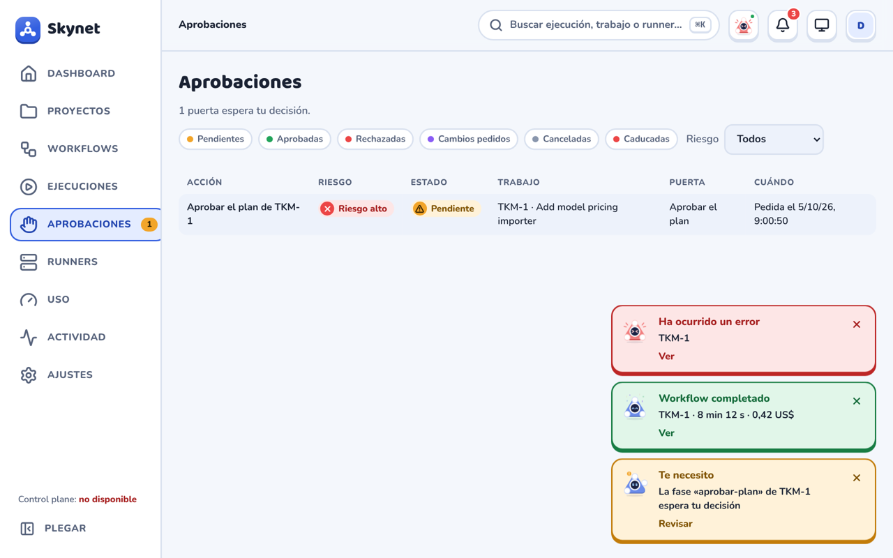

# Companion

La mascota de Skynet se llama **Skyny** (diminutivo de Skynet) y cuenta cómo van los agentes. Se presenta por su nombre en el saludo del Dashboard y en Ajustes › Companion. Es el isotipo convertido en personaje: el nodo de arriba es la cabeza, los dos de abajo son las manos y el anillo es la cara, con un visor oscuro donde cambian los ojos. Es plana y en pastel, como el resto de la web, y no usa imágenes, solo SVG con CSS.

Plan del hito CO: `plans/estudio-companion.md` (carpeta de proyecto), aprobado el 2026-10-24. Solo web; la app de escritorio que planteaba la issue #140 queda descartada.

| PR | Qué añade |
|---|---|
| CO-A | la mascota, el motor de estados, la galería de Ajustes y los primeros usos estáticos (login, 404, estados vacíos) |
| CO-B | el companion global: stream en vivo (`after=latest`, `types=`), mascota y menú en la barra, campana y avisos |
| CO-C | la mascota en las páginas (Dashboard, proyecto, ejecución, listas, Uso) y los avisos fuera de la pestaña |

## Componente

```tsx
import { Companion } from './components/companion/Companion'

<Companion state="running" size={56} />                       // decorativa: el texto va al lado
<Companion state="waiting" size={144} label="Mascota de Skynet" /> // se anuncia como imagen
<Companion state="success" size={30} still />                  // quieta (listas, nodos, galerías)
```

- **Colores.** El cuerpo es `--primary` mezclado con blanco, así que sigue al acento (UI-G) y al tema. Los nodos y el visor usan `--companion-node` y `--companion-visor`, y los efectos los colores de estado (`--ok`, `--warn`, `--live`, `--bad`, `--idle`). El error tiñe el cuerpo de rojo; «Sin conexión» y «Cancelado» lo pasan a gris.
- **Tamaños.** 128–160 px en los héroes, 96 px en los estados vacíos, 56–80 px en las cabeceras, 30–40 px en avisos y listas, y 16 px en la pestaña. Por debajo de 32 px desaparecen los efectos, el brillo y la sombra, y el contorno se engrosa.
- **Accesibilidad.** Sin `label` lleva `aria-hidden`, y el estado tiene que decirse en el texto de al lado. Con `label` es `role="img"` y se anuncia como «label: Expresión». El estado nunca se transmite solo con el color: también cambian los ojos, el gesto y la insignia.

## Expresiones y estados

La traducción a expresiones está en `components/companion/state.ts`: funciones puras con tests de tabla.

| Expresión | Gesto | Cuándo |
|---|---|---|
| Inactivo (`sleeping`) | ojos cerrados, «zZ» | nada en marcha ni pendiente durante 5 min |
| En espera (`ready`) | parpadea | agente `QUEUED`, fase `PENDING`/`READY`, ejecución `PENDING` |
| Pensando (`thinking`) | mira arriba, cabeza ladeada, «…» | agente `STARTING`/`THINKING`, fase `STARTING` |
| Ejecutando (`running`) | ojos «^ ^», manos alternas, líneas de velocidad | agente `EXECUTING`, fase `RUNNING` |
| Revisando (`reviewing`) | mira el portátil | fase con una verificación `QUEUED`/`RUNNING` |
| Éxito (`success`) | salta, confeti | `COMPLETED`, `SUCCEEDED` |
| Error (`error`) | «> <», cuerpo rojo, sacudida | `FAILED` |
| Te necesita (`waiting`) | levanta la mano y saluda, «!» | `WAITING_FOR_APPROVAL` (W5), `WAITING_FOR_INPUT` |
| En pausa (`paused`) | ojos «– –», insignia de pausa | fase con un reintento programado (`notBefore` en el futuro) |
| Sin conexión (`offline`) | gris, insignia sin señal | agente `UNRESPONSIVE`, stream en vivo caído |
| Cancelado (`cancelled`) | gris, quieto | `CANCELLED`, fase `SKIPPED` |

- **`agentExpression`, `stageExpression` y `runExpression`.** Cuando hay varias expresiones a la vez (fases en paralelo, varios agentes), gana la de más prioridad: Te necesita › Error › Sin conexión › Revisando › Ejecutando › Pensando › En pausa › En espera.
- **`globalExpression`.** Calcula la mascota de toda la web (CO-B). El orden es: Sin conexión › error sin ver › aprobaciones pendientes › trabajo en curso › Éxito (durante 8 s) › En espera › Inactivo, a partir de 5 minutos sin nada.

## Movimiento

- **Animaciones.** Solo `transform` y `opacity`. «Ejecutando» repite un ciclo de 4 fotogramas en 1,2 s.
- **Cambio de expresión.** El visor parpadea: se cierra en 110 ms (`SWAP_MS`), cambian los ojos y se abre. Si la expresión cambia otra vez durante el parpadeo, se queda la última.
- **Sin animación.**
  - Con `still` (listas, nodos y galerías), salvo al pasar el ratón. Se quitan, no se pausan: una animación finita en pausa (el «pop» del éxito) no terminaría nunca, y las E2E de axe esperan a que acaben las finitas.
  - Con `prefers-reduced-motion`.
  - Con la pestaña oculta, el propio navegador las detiene.

## Companion global (CO-B)

`CompanionProvider` (en `AppShell`) es la única fuente: abre **un solo stream SSE** para toda la web y lo comparte por contexto (`useCompanion`).

- **Stream.** `/api/events/stream?after=latest&types=…`: empieza desde ahora (sin reenviar el histórico) y solo trae los tipos de `COMPANION_EVENT_TYPES` (`notices.ts`): `workflow.*`, `run.resumed`, `stage.status.changed`, `stage.retry.scheduled`, `stage.verification.*`, `agent.status.changed`, `agent.rate_limit` y `approval.*`. Al reconectar, el navegador manda `Last-Event-ID` y el servidor sigue desde ahí; además se releen las ejecuciones y las aprobaciones.
- **Estado de partida.** Las ejecuciones `PENDING` y `RUNNING` (`GET /api/workflow-runs?status=PENDING&status=RUNNING&size=50`, cada 30 s como red de seguridad) y las aprobaciones pendientes (`usePendingApprovals`, cada 10 s). Los cambios de fases y agentes se aplican en memoria con `applyEvent`, como en la página de ejecución.
- **Cara global.** `globalExpression`: Sin conexión si el stream lleva más de 5 s caído, Error mientras haya un fallo sin ver (se da por visto al abrir esa ejecución o al cerrar la campana), Te necesita con aprobaciones pendientes, luego el trabajo en curso, Éxito durante 8 s y, tras 5 min sin nada, Inactivo.



### Barra superior

- **Mascota (34 px).** Es un botón con nombre accesible («Skynet: Ejecutando. 2 ejecuciones activas»). Lleva un punto verde si hay algo en vivo, y al pasar el ratón dice lo mismo en un tooltip.
- **Menú rápido:** Ejecuciones activas (n), Te necesitan (n), Avisos recientes (abre la campana), Silenciar 1 h / Quitar el silencio y Ajustes del companion.
- **Campana.** Guarda los últimos 50 avisos, cada uno con su cara, su hora y un enlace. El número rojo cuenta los no leídos, que quedan leídos al cerrarla. «Vaciar los avisos» la deja limpia.

### Avisos

| Evento | Aviso | Se cierra |
|---|---|---|
| `approval.requested` | «Te necesito · La fase «aprobar» de DEMO-9 espera tu decisión» · Revisar | al decidir (`approval.granted`/`rejected`/`expired`) o cerrar |
| agente `WAITING_FOR_INPUT` | «DEMO-9 te pregunta algo» · Ver | al cerrar |
| ejecución `SUCCEEDED` | «Workflow completado · DEMO-11 · 8 min · 0,42 $» | solo, a los 6 s |
| ejecución `FAILED` | «Ha ocurrido un error · DEMO-7 · fase «tests»» · Ver | al cerrar |
| `workflow.started`, `run.resumed` | «Ejecutando workflow · DEMO-9 · Nombre del workflow» | solo, a los 4 s |
| agente `UNRESPONSIVE` | «El agente de DEMO-12 no responde» · Ver | al cerrar |
| `agent.rate_limit` (no `allowed`) | «Claude Code está al límite · DEMO-9 · reintento a las 18:40» | solo, a los 6 s |

Reglas contra el ruido (`pushToast`):

- **Nada de cambios internos.** Pensando ↔ ejecutando, herramientas o fases que avanzan no avisan.
- **Agrupar.** Dos o más del mismo tipo con menos de 10 s entre ellos van en una tarjeta («3 ejecuciones completadas · DEMO-9, DEMO-11 y DEMO-12», con «Ver todas»).
- **Como mucho 3 a la vez.** La más antigua sale, pero sigue en la campana.
- **La ejecución que estás mirando** no avisa (el aviso entra leído en la campana), salvo las aprobaciones.
- **Silenciar 1 h** y la opción «Avisos flotantes» de Ajustes quitan las tarjetas, no la campana.

La zona de avisos es `aria-live="polite"` (sin `role="status"`, que ya usan los mensajes de las páginas). Abajo a la derecha; en el móvil, arriba.

### Ajustes

En Ajustes › Companion hay opciones que valen **solo para este navegador** (`localStorage`, `prefs.ts`): «Mostrar la mascota en la barra superior» y «Avisos flotantes». El silencio de 1 h se guarda en el mismo sitio.

## En las páginas y fuera de la pestaña (CO-C)

### Mascota que asoma

En la cabecera, a la derecha del título, asoma una mascota de 92 px (80 px en Proyecto) con un bocadillo corto (`CompanionPeek`, textos en `peek.ts`):

- **Dashboard:** la cara global y «1 aprobación te espera», «¡Todo en marcha! 🚀», «Algo ha fallado» o «Todo al día».
- **Proyecto:** la cara más fuerte de sus ejecuciones en marcha y «2 ejecuciones en marcha» o «Nada en marcha».
- **Uso:** En pausa y «Vamos justos de cuota» si hay alertas de cuota; si no, En espera y «Hay cuota de sobra». Solo cuando hay datos.

Bajo la cabecera del Dashboard va la tarjeta de saludo (`CompanionHello`): «Hola, soy Skyny. Hay 1 ejecución en marcha y 1 aprobación esperándote.» con atajos a revisar la aprobación, lanzar un workflow y ver la última ejecución.

### Ejecución, tabla y grafo

- **Banda «Qué pasa ahora»** (`RunBand`), bajo el progreso de la ejecución: la mascota de 56 px y quién trabaja y en qué («Claude Code está usando Read», «La fase «Plan» espera tu decisión», «Ha fallado la fase «tests»»), con fase, duración y coste debajo. Se queda quieta cuando la ejecución termina.
- **Tabla de ejecuciones:** la columna Estado lleva la cara de 30 px de cada ejecución junto a la pastilla.
- **Grafo:** las fases y los agentes llevan la cara (22 y 18 px) en lugar del icono de estado.

Las caras pequeñas van quietas (`still`) para que una lista no se mueva entera.

### Fuera de la pestaña

- **Título:** con avisos sin leer, «(2) Skynet»; al leerlos vuelve a «Skynet».
- **Favicon:** con Te necesita o Error, la cara de la mascota (SVG con colores fijos, porque el favicon no ve los tokens); si no, el logo.
- **Avisos del navegador** (opcional, Ajustes › Companion › «Avisos del navegador con la pestaña oculta»): al activarlo se pide permiso. Solo salen con la pestaña oculta y para aprobaciones, preguntas, fallos y éxitos. Llevan clave, nombre y fase, nunca prompts ni salidas, y uno por ejecución (`tag`), así que el siguiente sustituye al anterior. Al pulsarlo se enfoca la pestaña y se abre su enlace. El silencio de 1 h también los calla.

## Dónde aparece (CO-A)

- **Login:** héroe En espera de 128 px.
- **Estados vacíos (`EmptyState` con `companion`):**
  - Proyectos, Ejecuciones y Aprobaciones sin nada todavía: Inactivo.
  - Runners sin registrar: Sin conexión.
  - Uso sin datos: En pausa.
  - 404: Pensando.
  - Con filtros activos se mantiene el icono.
- **Ajustes › Companion:** galería con todas las expresiones; al elegir una, la grande cambia con su parpadeo.
