# Galería visual de Skynet

<!-- Generado por web/visual/finish.ts a partir de web/visual/navigation-map.json: no editar a mano. -->

Capturas de todas las pantallas de Skynet con datos de demostración (proyecto `DEMO`, repositorio
`analizador-texto`), en escritorio y móvil, tema claro y oscuro. Sirven de referencia para
rediseñar, comparar antes y después y preparar publicaciones.

| Combinación | Tamaño | Carpeta | En Git |
| --- | --- | --- | --- |
| desktop · light | 1440 × 1000 | `desktop/light/` | sí (canónica) |
| desktop · dark | 1440 × 1000 | `desktop/dark/` | no: ZIP y artifact |
| mobile · light | 390 × 844 | `mobile/light/` | no: ZIP y artifact |
| mobile · dark | 390 × 844 | `mobile/dark/` | no: ZIP y artifact |

En Git solo se guarda la combinación canónica (`desktop/light`); las demás y
`skynet-screenshots.zip` salen al regenerar en local o en la Action **Galería visual**.

## Mapa de navegación

[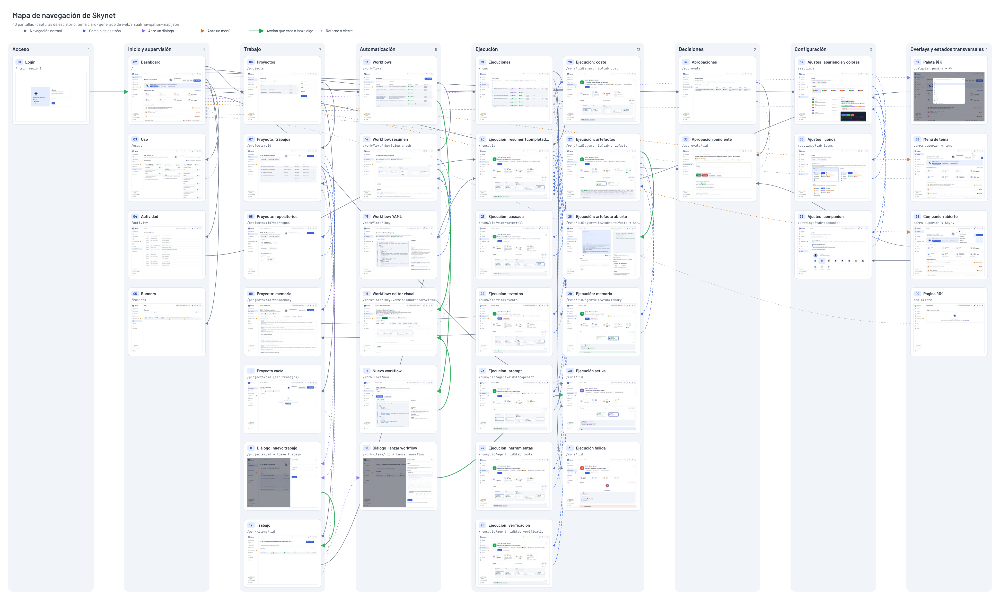](map/navigation-map.png)

Todas las pantallas con sus relaciones, agrupadas por zona: [HTML navegable](map/navigation-map.html)
(zoom, arrastrar y ficha de cada pantalla), [SVG para Figma y Miro](map/navigation-map.svg),
[PDF](map/navigation-map.pdf) y [JSON](map/navigation-map.json). Cómo abrirlo e importarlo, en
[`map/README.md`](map/README.md).

## Redes sociales

En `social/`, 6 pantallas en 3 formatos (`landscape` 1600 × 900, `square` 1080 × 1080, `portrait` 1080 × 1350): la
captura de escritorio en una ventana y la de móvil en un teléfono, con su titular. Se escalan
sin deformar y nunca por encima del 100 %; solo se recortan por abajo y por la derecha. No se
guardan en Git: están en el ZIP y en el artifact, y `npm run screenshots:social [carpeta]` las
rehace a partir de una galería ya generada. La selección y los titulares están en
`social` de `web/visual/navigation-map.json`.

| Pantalla | Tema | Titular |
| --- | --- | --- |
| Dashboard | light | Tus agentes, a la vista |
| Ejecución: cascada | light | Cada fase de una ejecución, en cascada |
| Workflow: editor visual | dark | Workflows con un editor visual |
| Aprobación pendiente | light | Tú decides antes de seguir |
| Proyecto: trabajos | dark | Cada proyecto, con su trabajo |
| Ejecución activa | dark | Ejecuciones en directo |

## Acceso

| # | Pantalla | Ruta o estado | Vista | Variantes |
| --- | --- | --- | --- | --- |
| 1 | **Login** | `/ (sin sesión)` | <a href="desktop/light/01-login.png">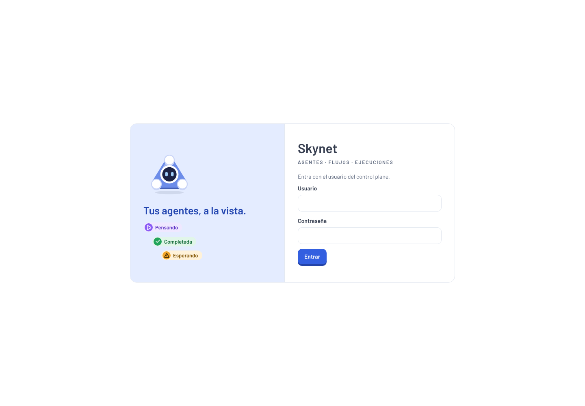</a> | [desktop dark](desktop/dark/01-login.png) · [mobile light](mobile/light/01-login.png) · [mobile dark](mobile/dark/01-login.png) |

## Inicio y supervisión

| # | Pantalla | Ruta o estado | Vista | Variantes |
| --- | --- | --- | --- | --- |
| 2 | **Dashboard**<br><sub>Con actividad y con una aprobación en «Necesita tu atención»: una sola captura cubre los dos estados.</sub> | `/` | <a href="desktop/light/02-dashboard.png">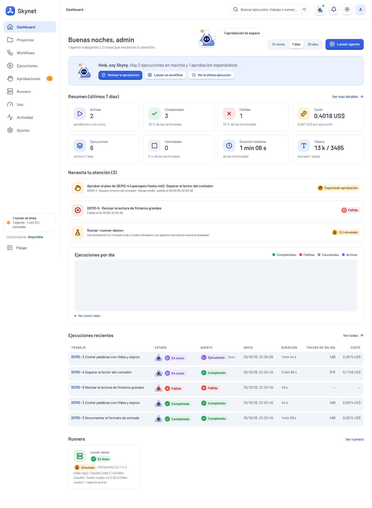</a> | [desktop dark](desktop/dark/02-dashboard.png) · [mobile light](mobile/light/02-dashboard.png) · [mobile dark](mobile/dark/02-dashboard.png) |
| 3 | **Uso** | `/usage` | <a href="desktop/light/03-usage.png">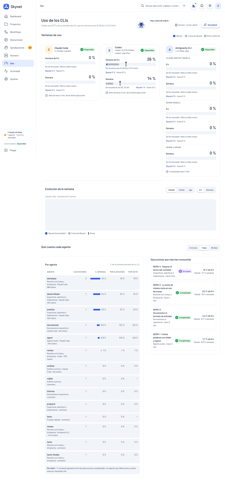</a> | [desktop dark](desktop/dark/03-usage.png) · [mobile light](mobile/light/03-usage.png) · [mobile dark](mobile/dark/03-usage.png) |
| 4 | **Actividad** | `/activity` | <a href="desktop/light/04-activity.png">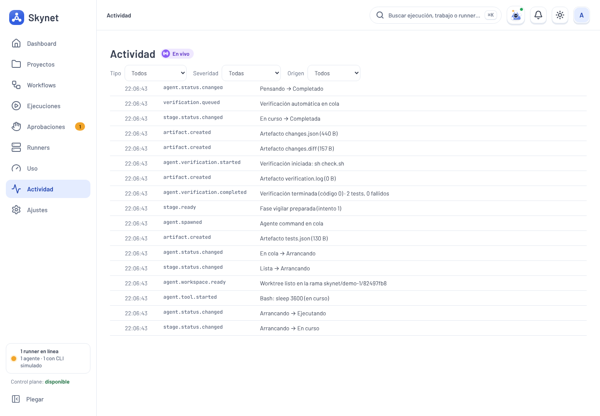</a> | [desktop dark](desktop/dark/04-activity.png) · [mobile light](mobile/light/04-activity.png) · [mobile dark](mobile/dark/04-activity.png) |
| 5 | **Runners** | `/runners` | <a href="desktop/light/05-runners.png">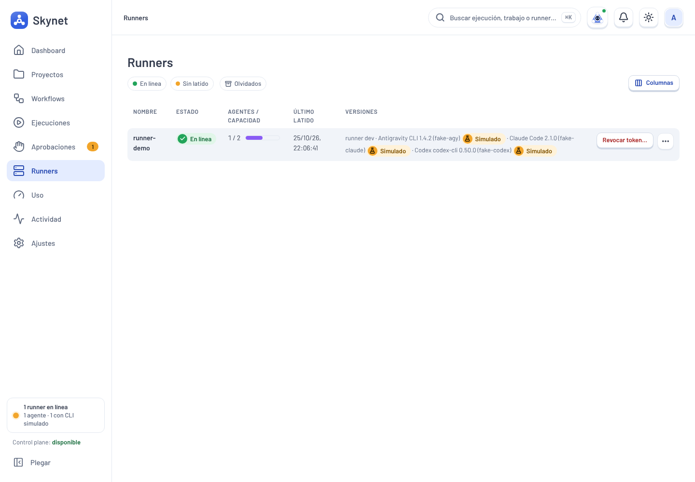</a> | [desktop dark](desktop/dark/05-runners.png) · [mobile light](mobile/light/05-runners.png) · [mobile dark](mobile/dark/05-runners.png) |

## Trabajo

| # | Pantalla | Ruta o estado | Vista | Variantes |
| --- | --- | --- | --- | --- |
| 6 | **Proyectos** | `/projects` | <a href="desktop/light/06-projects.png">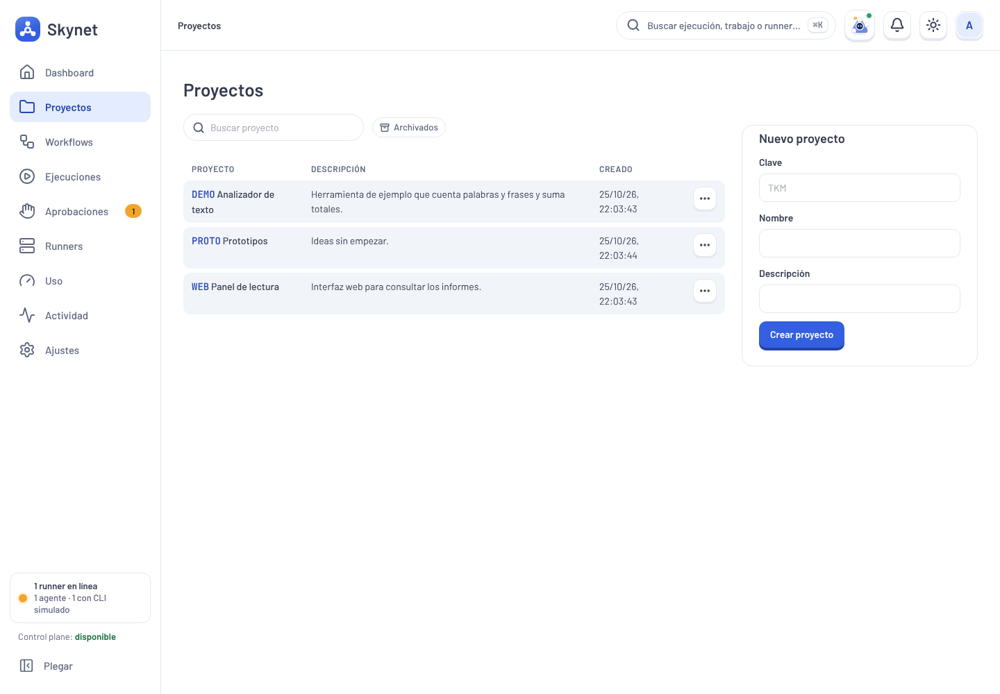</a> | [desktop dark](desktop/dark/06-projects.png) · [mobile light](mobile/light/06-projects.png) · [mobile dark](mobile/dark/06-projects.png) |
| 7 | **Proyecto: trabajos**<br><sub>El proyecto no tiene pestaña «Resumen»: su cabecera y la pestaña Trabajos (la de entrada) hacen de resumen.</sub> | `/projects/:id` | <a href="desktop/light/07-project-work.png">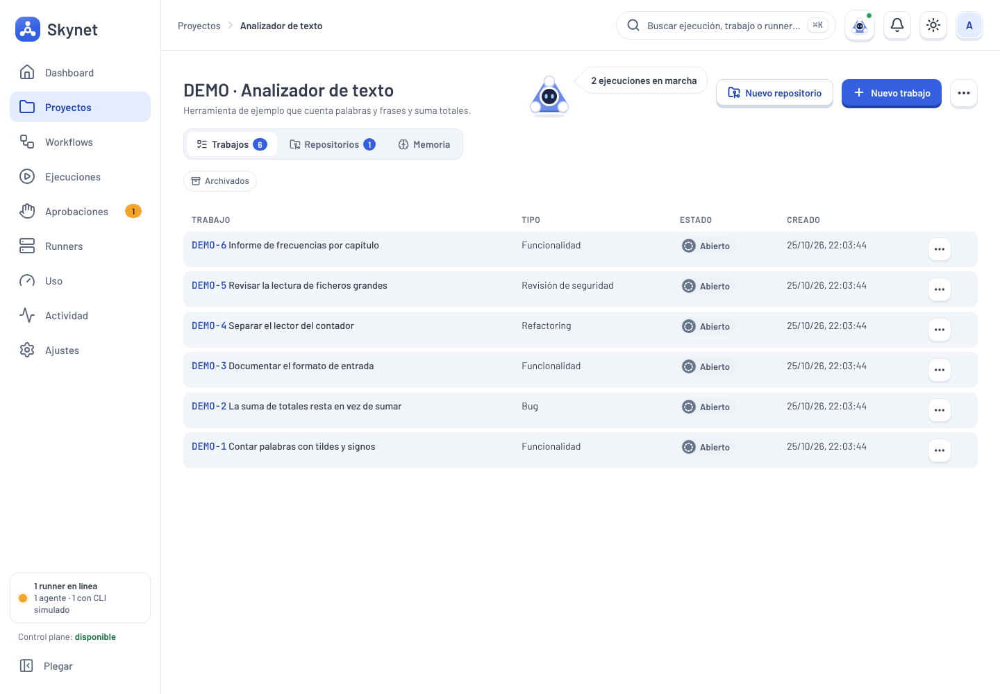</a> | [desktop dark](desktop/dark/07-project-work.png) · [mobile light](mobile/light/07-project-work.png) · [mobile dark](mobile/dark/07-project-work.png) |
| 8 | **Proyecto: repositorios** | `/projects/:id?tab=repos` | <a href="desktop/light/08-project-repos.png">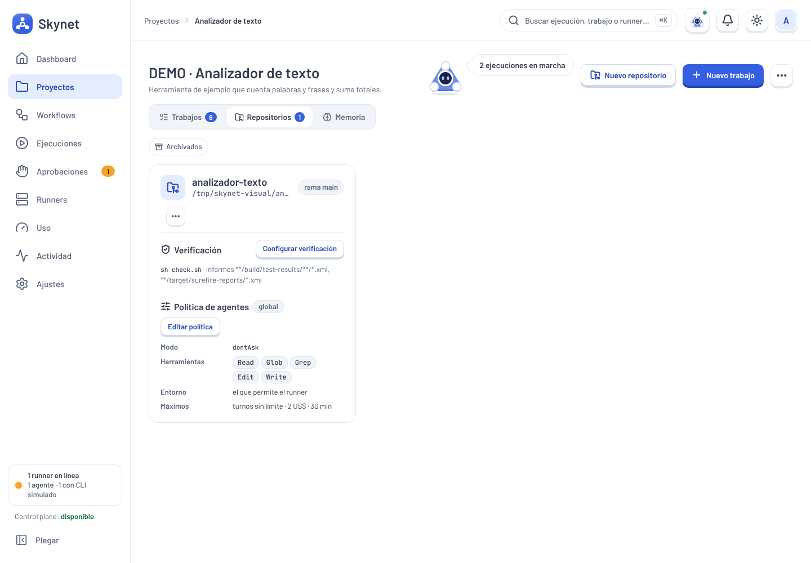</a> | [desktop dark](desktop/dark/08-project-repos.png) · [mobile light](mobile/light/08-project-repos.png) · [mobile dark](mobile/dark/08-project-repos.png) |
| 9 | **Proyecto: memoria** | `/projects/:id?tab=memory` | <a href="desktop/light/09-project-memory.png">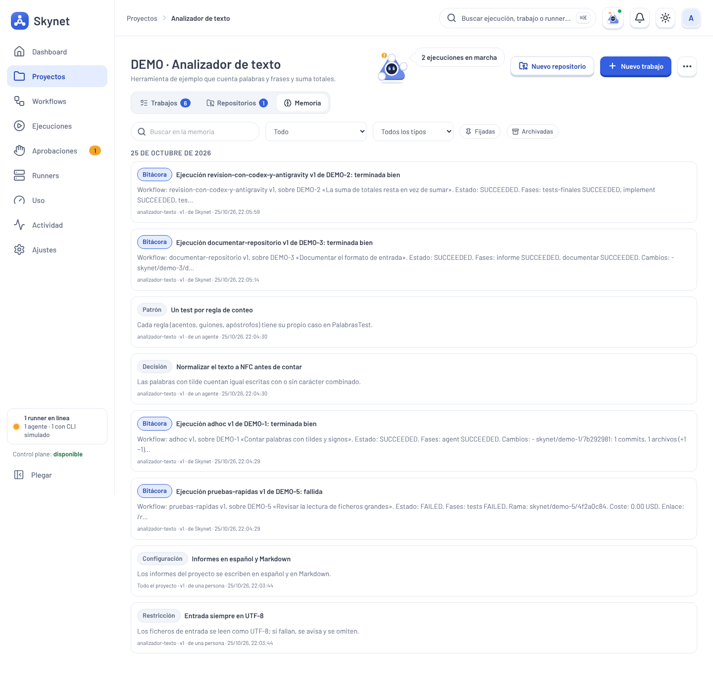</a> | [desktop dark](desktop/dark/09-project-memory.png) · [mobile light](mobile/light/09-project-memory.png) · [mobile dark](mobile/dark/09-project-memory.png) |
| 10 | **Proyecto vacío**<br><sub>Estado vacío: un proyecto recién creado.</sub> | `/projects/:id (sin trabajos)` | <a href="desktop/light/10-project-empty.png">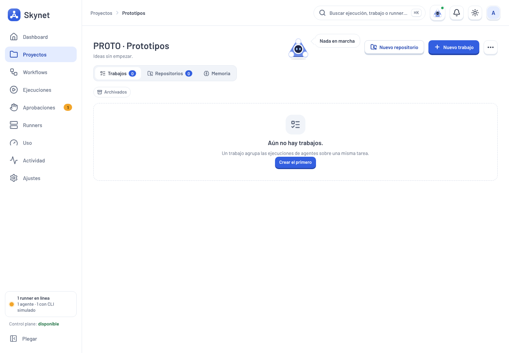</a> | [desktop dark](desktop/dark/10-project-empty.png) · [mobile light](mobile/light/10-project-empty.png) · [mobile dark](mobile/dark/10-project-empty.png) |
| 11 | **Diálogo: nuevo trabajo** | `/projects/:id → Nuevo trabajo` | <a href="desktop/light/11-new-work-item.png">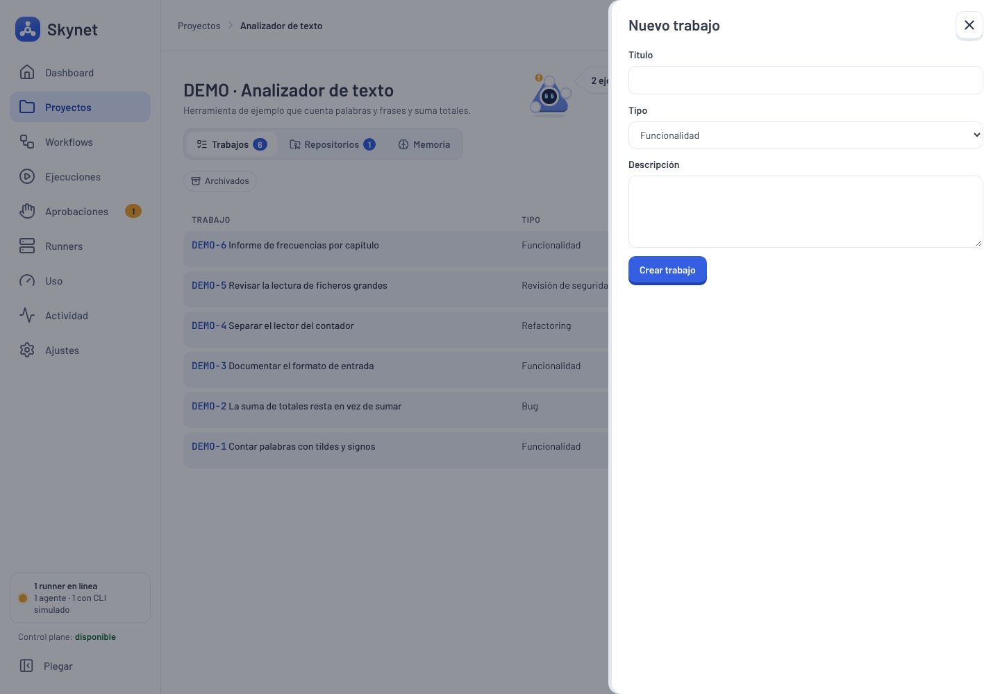</a> | [desktop dark](desktop/dark/11-new-work-item.png) · [mobile light](mobile/light/11-new-work-item.png) · [mobile dark](mobile/dark/11-new-work-item.png) |
| 12 | **Trabajo** | `/work-items/:id` | <a href="desktop/light/12-work-item.png">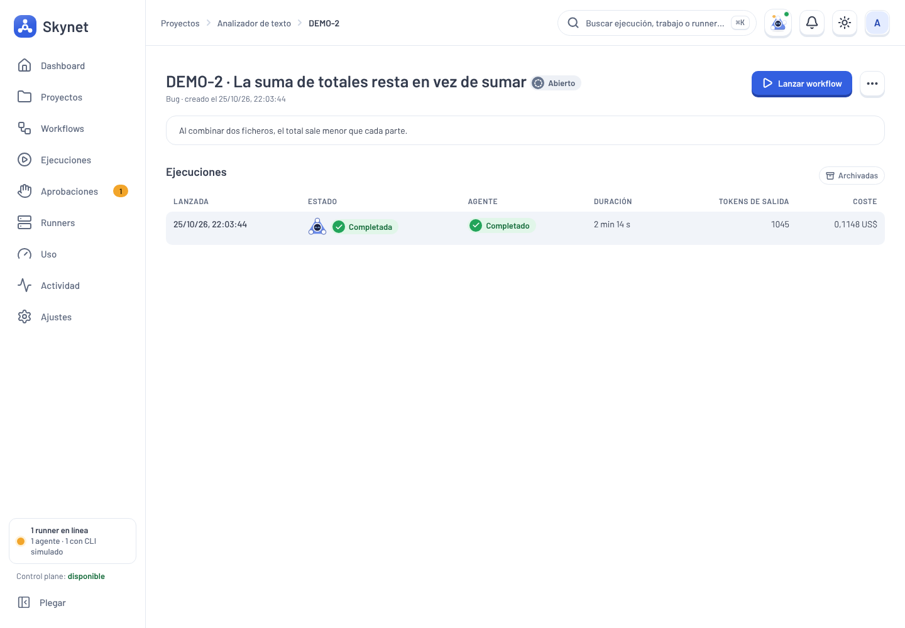</a> | [desktop dark](desktop/dark/12-work-item.png) · [mobile light](mobile/light/12-work-item.png) · [mobile dark](mobile/dark/12-work-item.png) |

## Automatización

| # | Pantalla | Ruta o estado | Vista | Variantes |
| --- | --- | --- | --- | --- |
| 13 | **Workflows** | `/workflows` | <a href="desktop/light/13-workflows.png">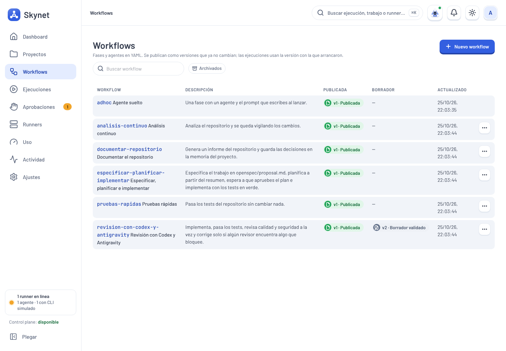</a> | [desktop dark](desktop/dark/13-workflows.png) · [mobile light](mobile/light/13-workflows.png) · [mobile dark](mobile/dark/13-workflows.png) |
| 14 | **Workflow: resumen**<br><sub>Versión publicada, con su grafo.</sub> | `/workflows/:key?view=graph` | <a href="desktop/light/14-workflow-summary.png">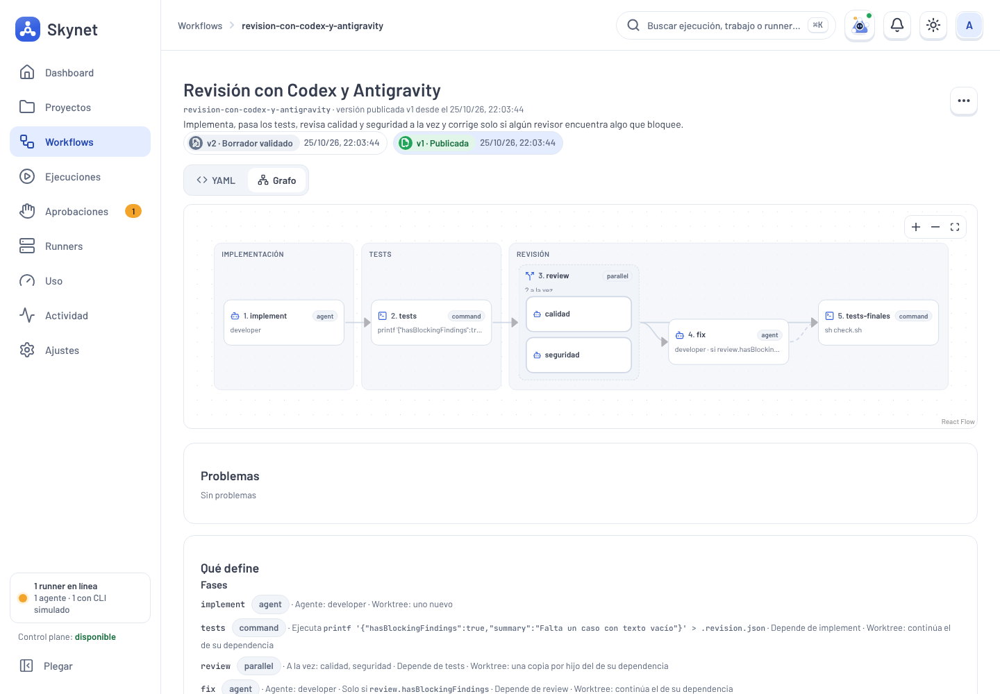</a> | [desktop dark](desktop/dark/14-workflow-summary.png) · [mobile light](mobile/light/14-workflow-summary.png) · [mobile dark](mobile/dark/14-workflow-summary.png) |
| 15 | **Workflow: YAML** | `/workflows/:key` | <a href="desktop/light/15-workflow-yaml.png">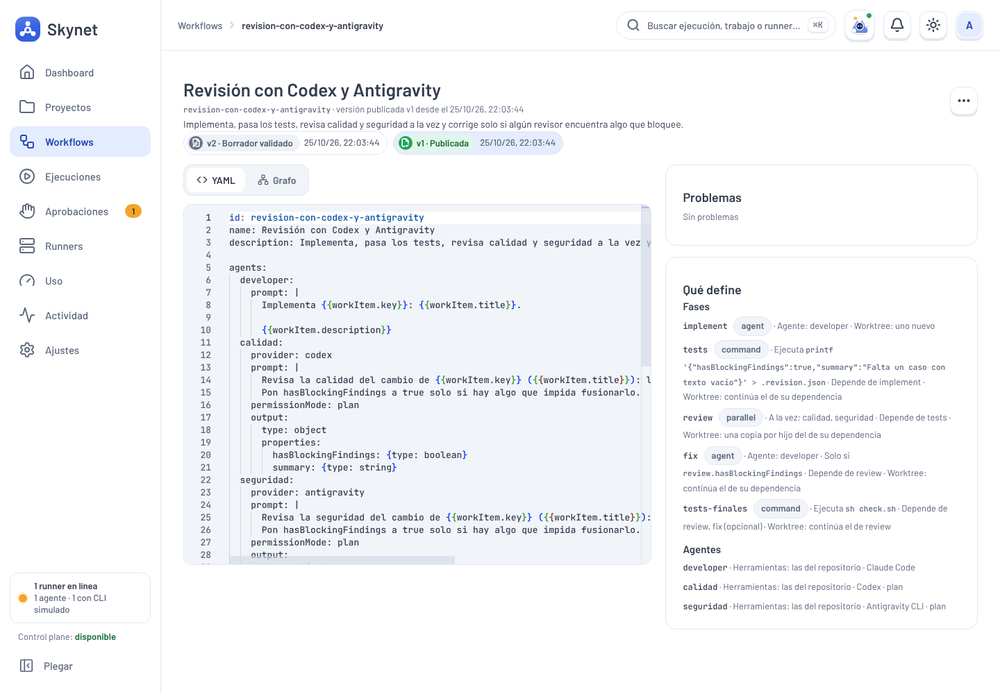</a> | [desktop dark](desktop/dark/15-workflow-yaml.png) · [mobile light](mobile/light/15-workflow-yaml.png) · [mobile dark](mobile/dark/15-workflow-yaml.png) |
| 16 | **Workflow: editor visual**<br><sub>Borrador v2 abierto en el grafo editable. En el móvil el grafo no se edita (solo se ve).</sub> | `/workflows/:key?version=:borrador&view=graph` | <a href="desktop/light/16-workflow-editor.png">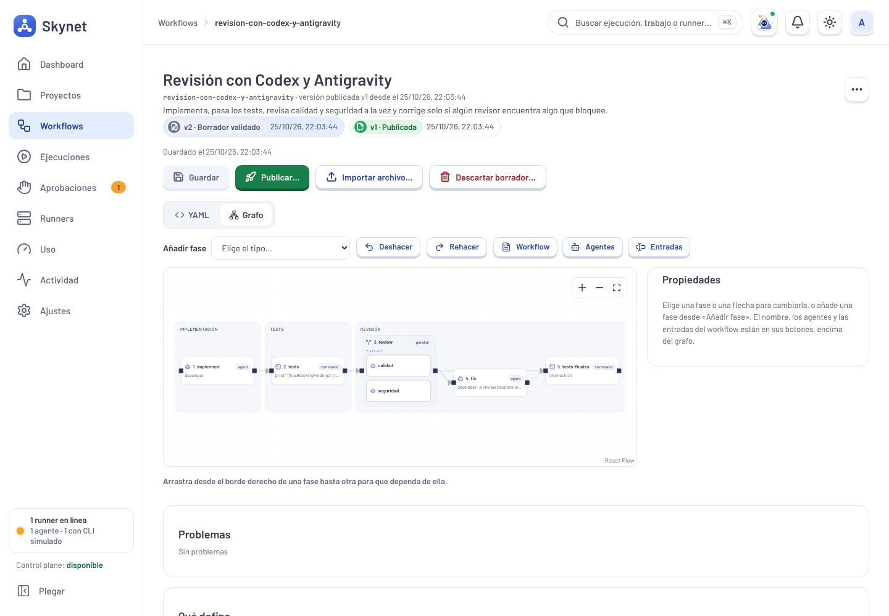</a> | [desktop dark](desktop/dark/16-workflow-editor.png) · [mobile light](mobile/light/16-workflow-editor.png) · [mobile dark](mobile/dark/16-workflow-editor.png) |
| 17 | **Nuevo workflow** | `/workflows/new` | <a href="desktop/light/17-workflow-new.png">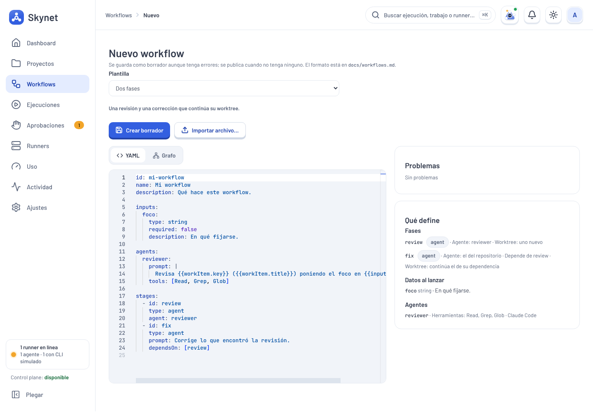</a> | [desktop dark](desktop/dark/17-workflow-new.png) · [mobile light](mobile/light/17-workflow-new.png) · [mobile dark](mobile/dark/17-workflow-new.png) |
| 18 | **Diálogo: lanzar workflow** | `/work-items/:id → Lanzar workflow` | <a href="desktop/light/18-launch-workflow.png">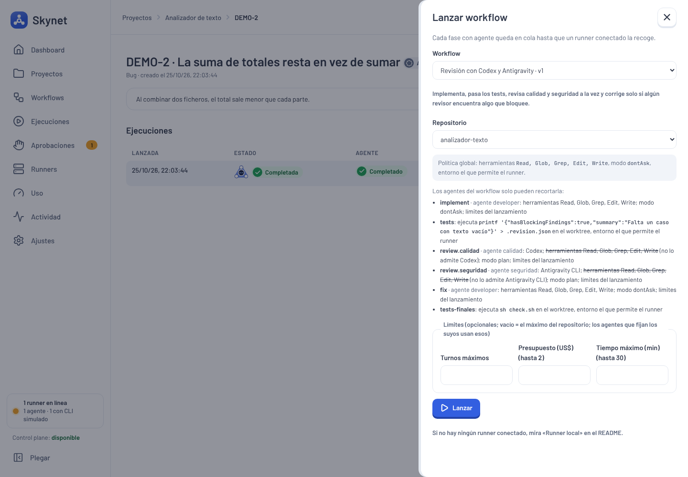</a> | [desktop dark](desktop/dark/18-launch-workflow.png) · [mobile light](mobile/light/18-launch-workflow.png) · [mobile dark](mobile/dark/18-launch-workflow.png) |

## Ejecución

| # | Pantalla | Ruta o estado | Vista | Variantes |
| --- | --- | --- | --- | --- |
| 19 | **Ejecuciones** | `/runs` | <a href="desktop/light/19-runs.png">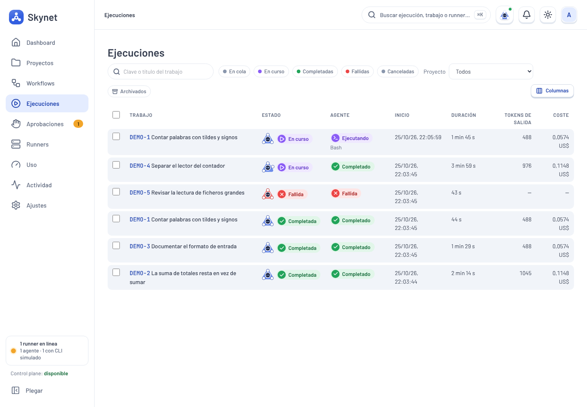</a> | [desktop dark](desktop/dark/19-runs.png) · [mobile light](mobile/light/19-runs.png) · [mobile dark](mobile/dark/19-runs.png) |
| 20 | **Ejecución: resumen (completada)**<br><sub>Ejecución completada de «Revisión con Codex y Antigravity». La conversación es la vista por defecto del panel central, así que esta captura también es «Ejecución: conversación».</sub> | `/runs/:id` | <a href="desktop/light/20-run-completed.png"></a> | [desktop dark](desktop/dark/20-run-completed.png) · [mobile light](mobile/light/20-run-completed.png) · [mobile dark](mobile/dark/20-run-completed.png) |
| 21 | **Ejecución: cascada** | `/runs/:id?view=waterfall` | <a href="desktop/light/21-run-waterfall.png">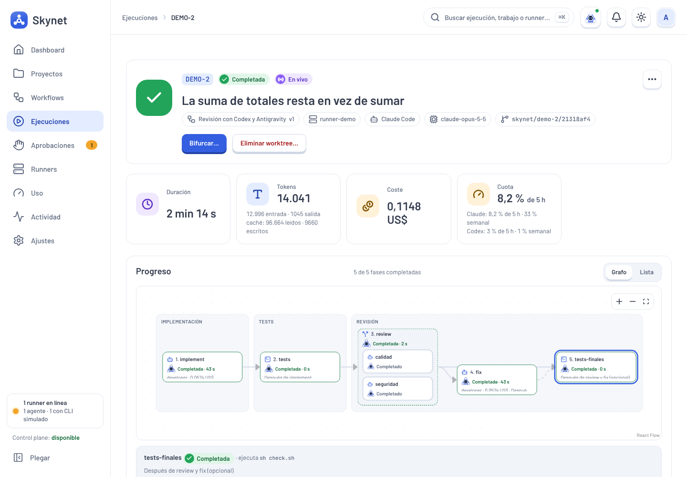</a> | [desktop dark](desktop/dark/21-run-waterfall.png) · [mobile light](mobile/light/21-run-waterfall.png) · [mobile dark](mobile/dark/21-run-waterfall.png) |
| 22 | **Ejecución: eventos** | `/runs/:id?view=events` | <a href="desktop/light/22-run-events.png"></a> | [desktop dark](desktop/dark/22-run-events.png) · [mobile light](mobile/light/22-run-events.png) · [mobile dark](mobile/dark/22-run-events.png) |
| 23 | **Ejecución: prompt** | `/runs/:id?agent=:id&tab=prompt` | <a href="desktop/light/23-run-prompt.png"></a> | [desktop dark](desktop/dark/23-run-prompt.png) · [mobile light](mobile/light/23-run-prompt.png) · [mobile dark](mobile/dark/23-run-prompt.png) |
| 24 | **Ejecución: herramientas** | `/runs/:id?agent=:id&tab=tools` | <a href="desktop/light/24-run-tools.png"></a> | [desktop dark](desktop/dark/24-run-tools.png) · [mobile light](mobile/light/24-run-tools.png) · [mobile dark](mobile/dark/24-run-tools.png) |
| 25 | **Ejecución: verificación** | `/runs/:id?agent=:id&tab=verification` | <a href="desktop/light/25-run-verification.png">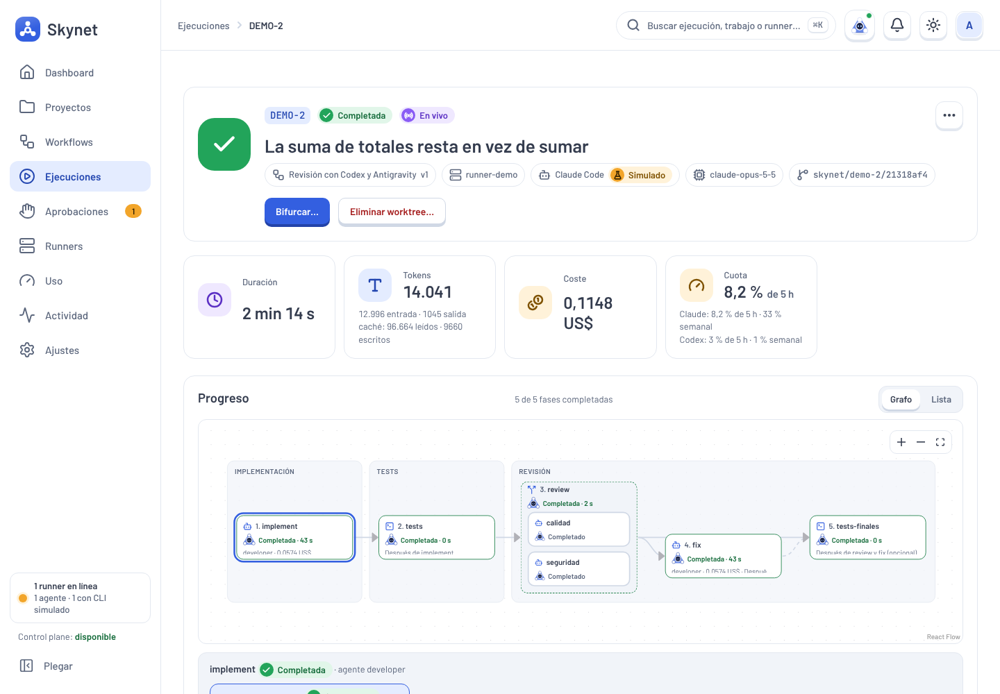</a> | [desktop dark](desktop/dark/25-run-verification.png) · [mobile light](mobile/light/25-run-verification.png) · [mobile dark](mobile/dark/25-run-verification.png) |
| 26 | **Ejecución: coste** | `/runs/:id?agent=:id&tab=cost` | <a href="desktop/light/26-run-cost.png"></a> | [desktop dark](desktop/dark/26-run-cost.png) · [mobile light](mobile/light/26-run-cost.png) · [mobile dark](mobile/dark/26-run-cost.png) |
| 27 | **Ejecución: artefactos**<br><sub>Ejecución de «Documentar el repositorio», con un informe declarado.</sub> | `/runs/:id?agent=:id&tab=artifacts` | <a href="desktop/light/27-run-artifacts.png">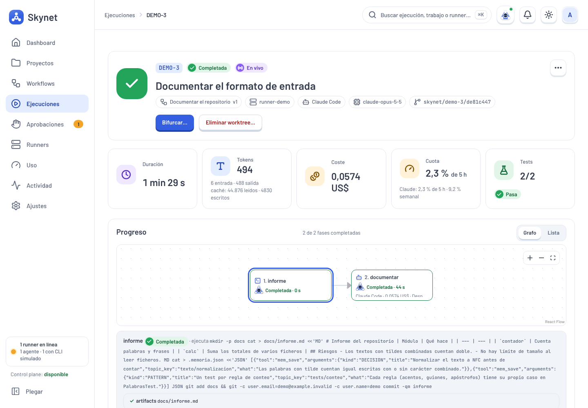</a> | [desktop dark](desktop/dark/27-run-artifacts.png) · [mobile light](mobile/light/27-run-artifacts.png) · [mobile dark](mobile/dark/27-run-artifacts.png) |
| 28 | **Ejecución: artefacto abierto** | `/runs/:id?agent=:id&tab=artifacts → Abrir` | <a href="desktop/light/28-run-artifact-open.png">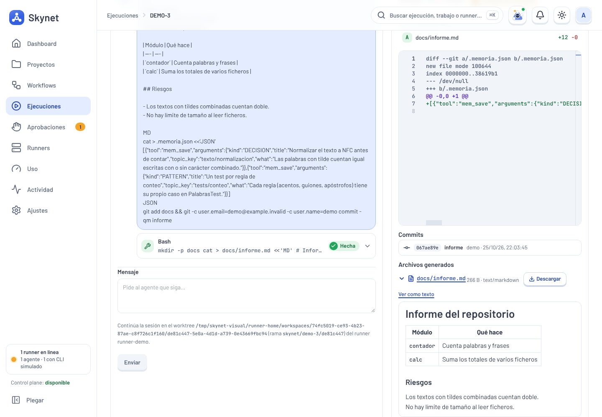</a> | [desktop dark](desktop/dark/28-run-artifact-open.png) · [mobile light](mobile/light/28-run-artifact-open.png) · [mobile dark](mobile/dark/28-run-artifact-open.png) |
| 29 | **Ejecución: memoria** | `/runs/:id?agent=:id&tab=memory` | <a href="desktop/light/29-run-memory.png">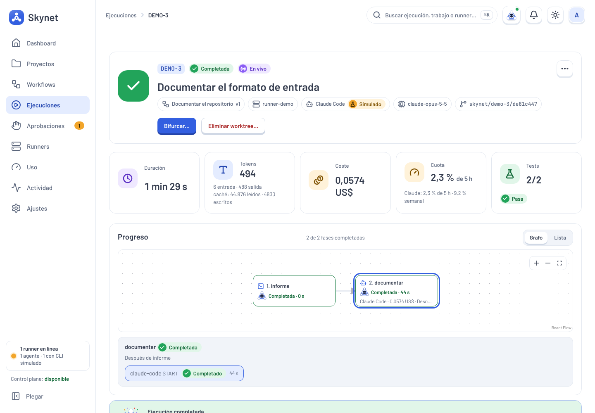</a> | [desktop dark](desktop/dark/29-run-memory.png) · [mobile light](mobile/light/29-run-memory.png) · [mobile dark](mobile/dark/29-run-memory.png) |
| 30 | **Ejecución activa**<br><sub>Una fase de comando larga mantiene la ejecución en curso mientras se captura.</sub> | `/runs/:id` | <a href="desktop/light/30-run-active.png">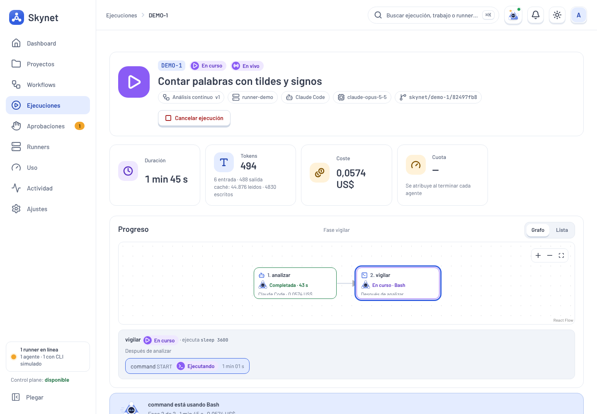</a> | [desktop dark](desktop/dark/30-run-active.png) · [mobile light](mobile/light/30-run-active.png) · [mobile dark](mobile/dark/30-run-active.png) |
| 31 | **Ejecución fallida**<br><sub>La verificación del repositorio falla.</sub> | `/runs/:id` | <a href="desktop/light/31-run-failed.png">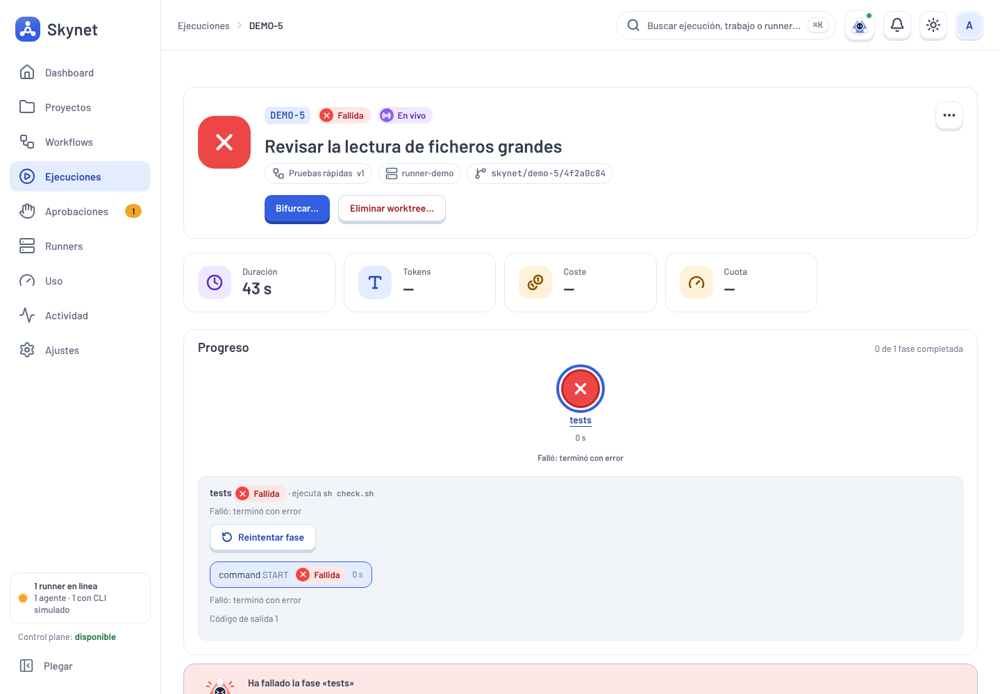</a> | [desktop dark](desktop/dark/31-run-failed.png) · [mobile light](mobile/light/31-run-failed.png) · [mobile dark](mobile/dark/31-run-failed.png) |

## Decisiones

| # | Pantalla | Ruta o estado | Vista | Variantes |
| --- | --- | --- | --- | --- |
| 32 | **Aprobaciones** | `/approvals` | <a href="desktop/light/32-approvals.png">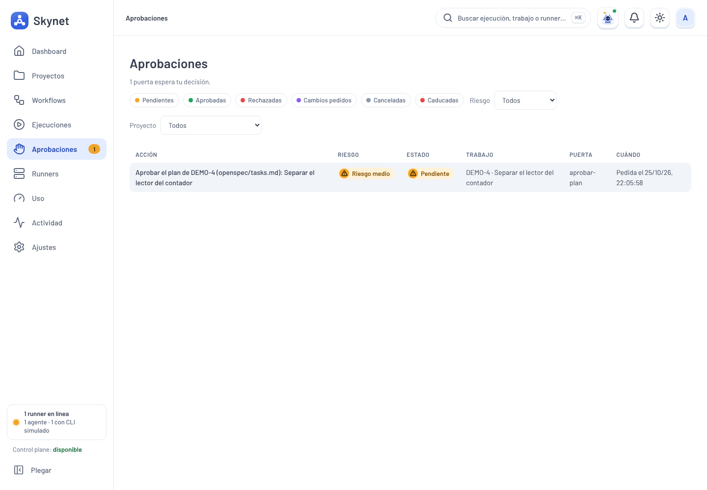</a> | [desktop dark](desktop/dark/32-approvals.png) · [mobile light](mobile/light/32-approvals.png) · [mobile dark](mobile/dark/32-approvals.png) |
| 33 | **Aprobación pendiente** | `/approvals/:id` | <a href="desktop/light/33-approval-pending.png">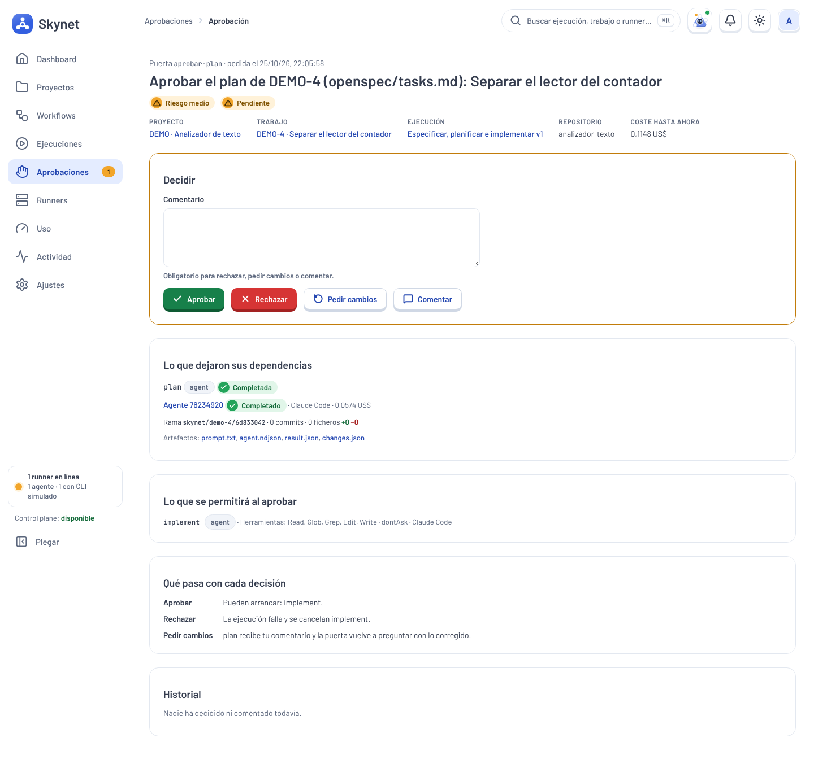</a> | [desktop dark](desktop/dark/33-approval-pending.png) · [mobile light](mobile/light/33-approval-pending.png) · [mobile dark](mobile/dark/33-approval-pending.png) |

## Configuración

| # | Pantalla | Ruta o estado | Vista | Variantes |
| --- | --- | --- | --- | --- |
| 34 | **Ajustes: apariencia y colores** | `/settings` | <a href="desktop/light/34-settings-colors.png">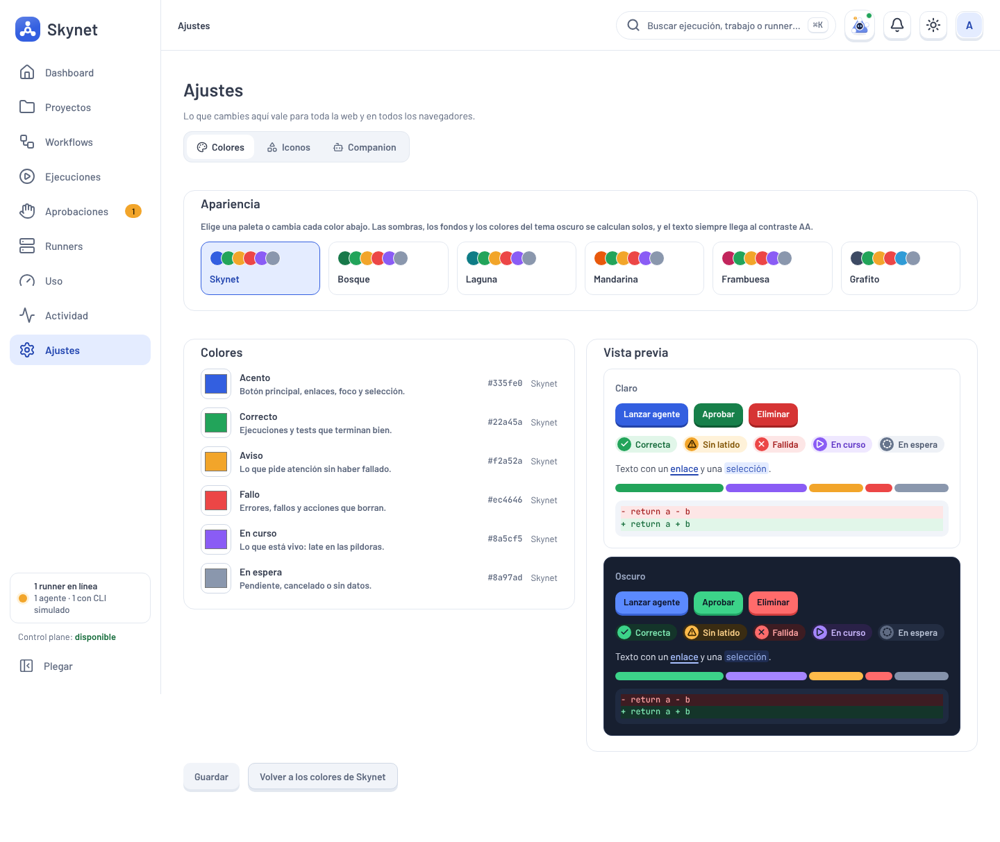</a> | [desktop dark](desktop/dark/34-settings-colors.png) · [mobile light](mobile/light/34-settings-colors.png) · [mobile dark](mobile/dark/34-settings-colors.png) |
| 35 | **Ajustes: iconos** | `/settings?tab=icons` | <a href="desktop/light/35-settings-icons.png">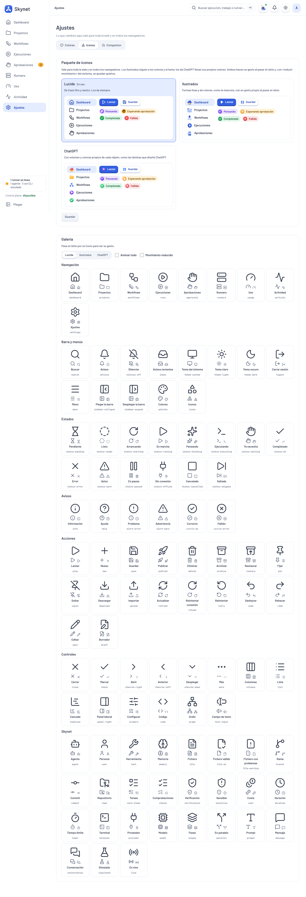</a> | [desktop dark](desktop/dark/35-settings-icons.png) · [mobile light](mobile/light/35-settings-icons.png) · [mobile dark](mobile/dark/35-settings-icons.png) |
| 36 | **Ajustes: companion** | `/settings?tab=companion` | <a href="desktop/light/36-settings-companion.png">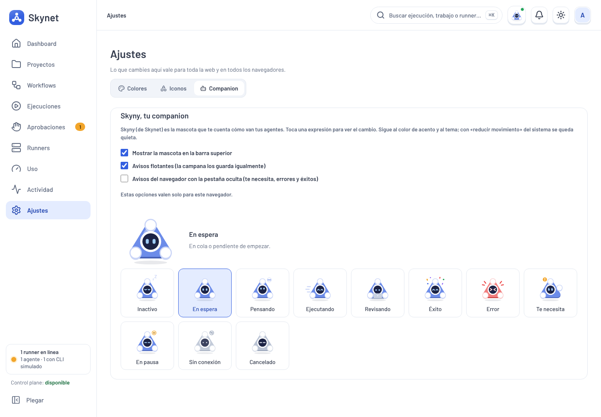</a> | [desktop dark](desktop/dark/36-settings-companion.png) · [mobile light](mobile/light/36-settings-companion.png) · [mobile dark](mobile/dark/36-settings-companion.png) |

## Overlays y estados transversales

| # | Pantalla | Ruta o estado | Vista | Variantes |
| --- | --- | --- | --- | --- |
| 37 | **Paleta ⌘K** | `cualquier página → ⌘K` | <a href="desktop/light/37-command-palette.png">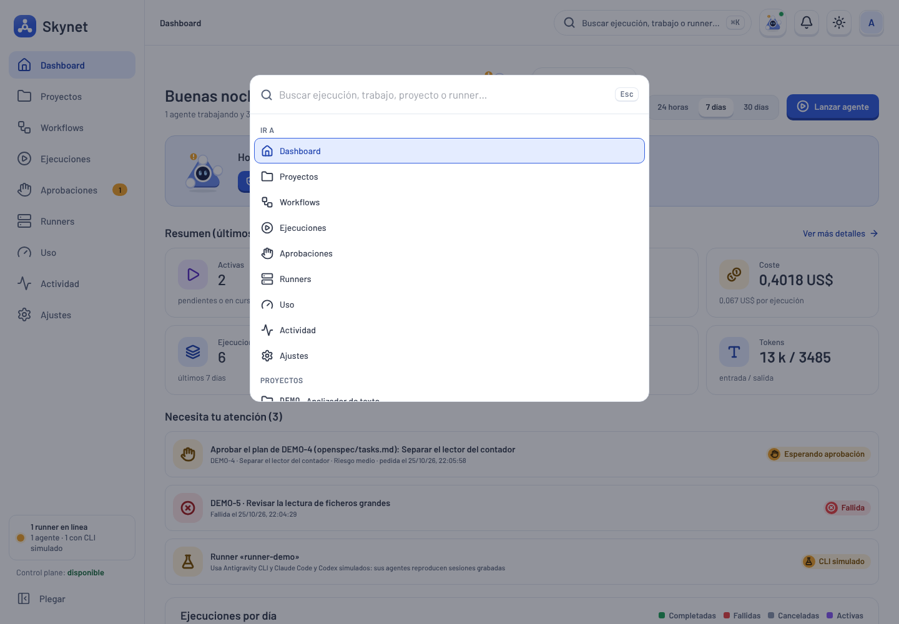</a> | [desktop dark](desktop/dark/37-command-palette.png) · [mobile light](mobile/light/37-command-palette.png) · [mobile dark](mobile/dark/37-command-palette.png) |
| 38 | **Menú de tema** | `barra superior → tema` | <a href="desktop/light/38-theme-menu.png">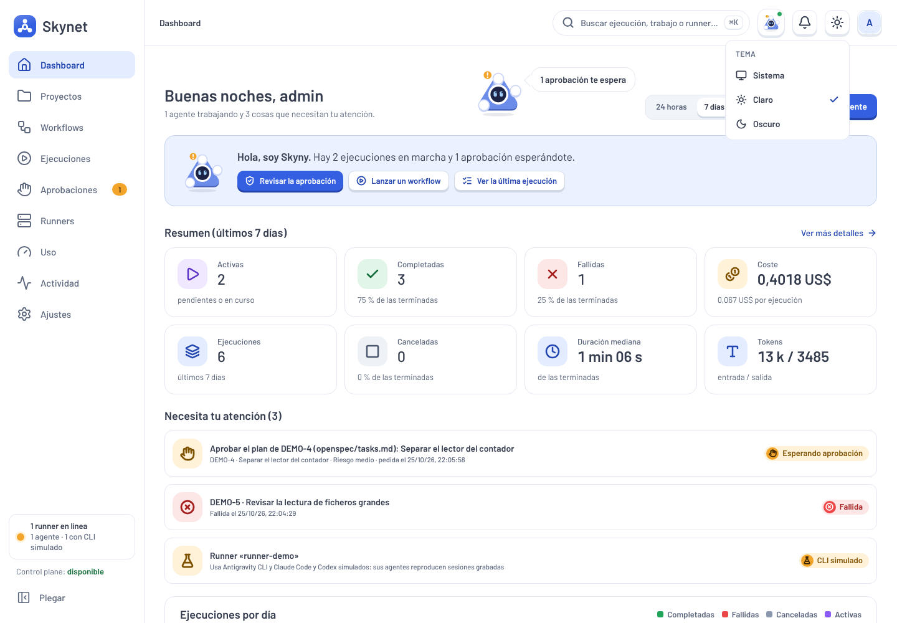</a> | [desktop dark](desktop/dark/38-theme-menu.png) · [mobile light](mobile/light/38-theme-menu.png) · [mobile dark](mobile/dark/38-theme-menu.png) |
| 39 | **Companion abierto**<br><sub>Con una aprobación pendiente, Skyny avisa de que te necesita.</sub> | `barra superior → Skyny` | <a href="desktop/light/39-companion-menu.png">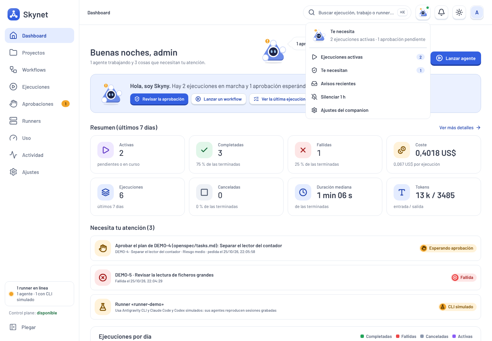</a> | [desktop dark](desktop/dark/39-companion-menu.png) · [mobile light](mobile/light/39-companion-menu.png) · [mobile dark](mobile/dark/39-companion-menu.png) |
| 40 | **Página 404** | `/no-existe` | <a href="desktop/light/40-not-found.png">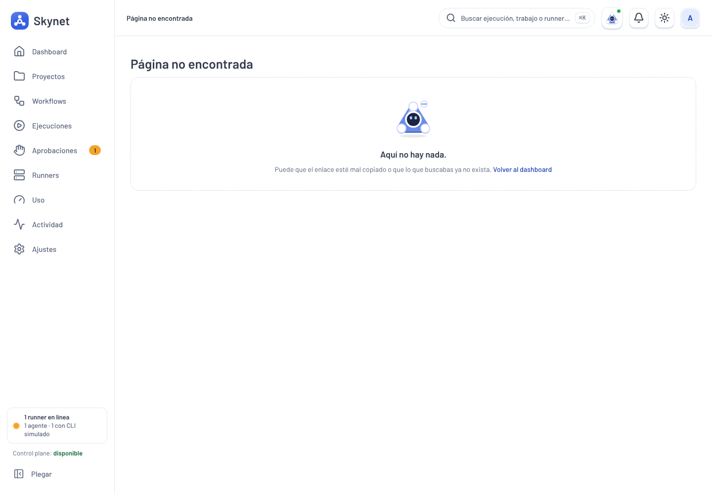</a> | [desktop dark](desktop/dark/40-not-found.png) · [mobile light](mobile/light/40-not-found.png) · [mobile dark](mobile/dark/40-not-found.png) |

## Excepciones

Ninguna: todas las pantallas del inventario tienen captura.

Notas sobre vistas pedidas que no existen como tales:

- **Proyecto: resumen**: el proyecto no tiene esa pestaña; la cabecera y la pestaña Trabajos hacen de resumen (`project-work`).
- **Ejecución: conversación**: es la vista por defecto del panel central y sale en `run-completed`.
- **Dashboard con actividad** y **con «Necesita tu atención»**: los dos estados caben en la misma captura (`dashboard`).

## Regenerar

```bash
cd web
npm run screenshots
```

Necesita Java 21, Node 22 y Docker (o PostgreSQL con `initdb` en el PATH). Siembra los datos en
una base desechable, nunca en la normal, y lo borra todo al terminar. Detalles en
[`docs/tests/probar-vs-a.md`](../tests/probar-vs-a.md).

Para generarla fuera del repositorio (sin tocar estas capturas), `SCREENSHOTS_OUT=/tmp/galeria
npm run screenshots`. Para revisar una galería ya generada sin volver a capturar,
`npm run screenshots:verify [carpeta]`.

Sin máquina preparada: Actions → **Galería visual** → *Run workflow*, y descarga el artifact
`skynet-screenshots` (no hace commit ni push).

Las fechas relativas («hace 3 min») y las duraciones salen iguales en cada ejecución porque el
reloj del navegador se para justo después de sembrar; las fechas absolutas y los ids son los del
día en que se generan.

**Cuándo actualizar las capturas de Git**: al cambiar el diseño de una pantalla, regenerar y
commitear solo `desktop/light/`, `map/` (sin `groups/`, que no se versiona) y este README.

## Descargar una imagen suelta

Cada imagen versionada tiene un enlace directo, por ejemplo:

```text
https://raw.githubusercontent.com/guilu/skynet/main/docs/screenshots/desktop/light/02-dashboard.png
```

En GitHub, abrir la imagen y pulsar **Download raw file**.
